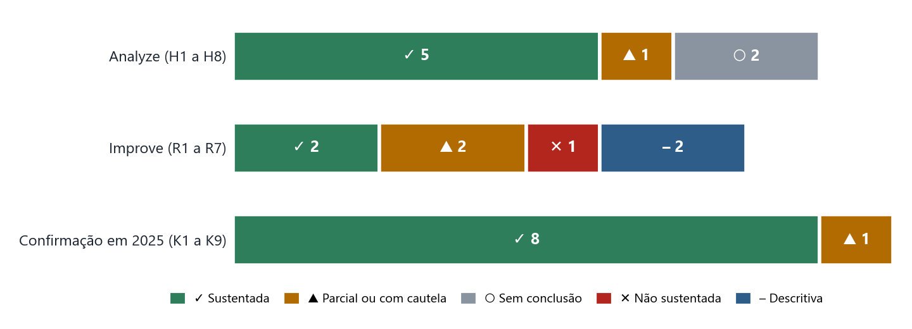

# Eu apostei antes de olhar os números. Veja no que deu

**Documento 1 · Hipóteses e resultados — Saúde fiscal do Rio de Janeiro · Siconfi 2023 a 2025 · 25/10/2026**

<b>24</b>afirmações testadas ao longo do projeto, cada uma com a regra de decisão escrita antes de ver o resultado

**Em poucas linhas.** Antes de cada conta, eu escrevi o que esperava e o que faria cada resultado significar. Assim, ninguém (nem eu) pode ajustar a história depois. Das afirmações testadas, a maioria se confirmou, algumas ficaram sem conclusão e uma não se sustentou. Os números são declarados pelas prefeituras e pelo estado, e não foram auditados. Gasto em saúde não mede a qualidade do atendimento.

## 1. Por que escrever a aposta antes

Quem analisa dados pode, sem querer, procurar até achar algo que pareça certo. Para evitar isso, cada pergunta tem um **critério de decisão escrito com data antes da conta**: o que eu espero e o que vou chamar de "confirmado", "parcial" ou "não sustentado". **"Sem conclusão" é um resultado válido**: quer dizer que os dados não permitem decidir, e não que não há diferença.

## 2. Etapa Analyze: o que explica o gasto?

A pergunta central: **o gasto baixo da Região Metropolitana em saúde por habitante se explica pela receita por habitante?**

| Id | A afirmação, em palavras simples | O que deu | Resultado |
|---|---|---|---|
| H1 | Com a mesma receita por habitante, a Metropolitana (sem a capital) não gasta diferente | Diferença de −4,4%, mas o intervalo vai de −18% a +12% | Sem conclusão |
| H2 | A Baixada (6 cidades) gasta menos do que a receita prevê | −3,5%, com intervalo de −18% a +14% | Sem conclusão |
| H3 | A capital gasta menos porque dedica fatia menor da receita à saúde | 35% a 37% abaixo do previsto; fatia de 19,6% contra mediana de 29,2% | Sustentada |
| H4 | O padrão de 2024 se repete em 2023 | Elasticidade 0,80; capital abaixo do previsto | Confirmada |
| H5 | Como se comportam as cidades de maior receita? | Quanto maior a receita, menor a fatia para a saúde (elasticidade 0,81) | Respondida |
| H6 | O gasto acompanha mais os repasses que a arrecadação própria | Repasses 0,68 contra 0,12 da receita própria | Confirmada |
| H7 | Casas de veraneio inflam a receita por habitante | Resíduo das Baixadas Litorâneas de −15% para −9% | Parcial |
| H8 | Todas cumprem o mínimo de 15% da saúde | 92 de 92; mediana de 23,3% | Confirmada |

> [!IMPORTANT]
> **A receita explica cerca de 80% da variação do gasto.** Quando se compara cidades com a mesma receita por habitante, a diferença da Metropolitana cai de 16% para 4%. O gasto segue os repasses (como os do SUS) muito mais que a arrecadação própria.

> [!WARNING]
> **Uma expectativa que o dado contrariou.** A expectativa inicial era que mais receita levasse a uma fatia maior para a saúde. Aconteceu o contrário: a fatia cai quando a receita sobe.

## 3. Etapa Improve: o que fazer com isso?

| Id | A ferramenta proposta | O que deu | Resultado |
|---|---|---|---|
| R1 | Triagem: listar cidades que gastam bem abaixo do que a receita prevê | 4 cidades sinalizadas; 2 das 3 do ano anterior se repetem | Sustentada |
| R2 | Comparar cada cidade com outras de receita parecida | A dispersão cai 46% (esperado: ao menos 20%) | Sustentada |
| R3 | Corrigir a população das cidades de veraneio | Somar visitantes **piorou** o resíduo, de −15% para −18% | Não sustentada |
| R4 | Teste de estresse: e se os repasses caírem? | Entre cidades 0,68; dentro da cidade 0,28 | Com cautela |
| R5 | Folga sobre o mínimo de 15% | 18 cidades com folga menor que 3 pontos | Descritiva |
| R6 | Comparar o SIOPS com o Siconfi | 11 cidades fora da faixa; serve como pergunta | Com cautela |
| R7 | Painel de limites da Lei de Responsabilidade Fiscal | 22 municípios declaram pessoal acima do limite prudencial | Descritiva |

> [!CAUTION]
> **Três apostas minhas erraram:** eu esperava as Baixadas Litorâneas bem representadas na triagem, no máximo 6 cidades com pouca folga e no máximo 10 com pessoal acima do limite. Os números reais foram 1 de 10, 18 e 22. Isso está registrado como resultado.

## 4. Etapa Control: o que resiste a um ano novo?

Abri os dados de 2025 **uma única vez**, depois de escrever as previsões. Das nove conclusões testadas, **oito se mantiveram**, uma enfraqueceu e nenhuma caiu.

| Id | Conclusão que veio de antes | Em 2025 | Resultado |
|---|---|---|---|
| K1 | A receita tem elasticidade abaixo de 1 | 0,74 (0,63 a 0,86) | Sustenta |
| K2 | A Metropolitana segue sem conclusão | −7,2% (−21% a +9%) | Sustenta |
| K3 | A capital fica abaixo do previsto | −33,5% | Sustenta |
| K4 | O gasto segue os repasses | 0,67 contra 0,11 | Sustenta |
| K5 | A lista da triagem se repete | Só 1 das 3 cidades repete | Enfraquece |
| K6 | Comparar por receita parecida lê melhor | Dispersão cai 46% | Sustenta |
| K7 | Repasses movem o gasto dentro da cidade | 0,59 (0,27 a 0,92) | Sustenta |
| K8 | Baixadas Litorâneas seguem abaixo do previsto | −15,6% | Sustenta |
| K9 | Somar visitantes continua piorando o resíduo | Piora nos 3 cenários | Sustenta |

**A triagem é estável como ordem, mas não como lista.** A ordem das cidades se mantém (correlação +0,83), mas só Niterói fica fora do intervalo nos três anos (−49%, −48% e −44%). Isso mostra que a ferramenta serve para perguntar, e não para fazer lista fixa.

## 5. O que este documento não diz

- **Não diz que alguma cidade está errada.** Uma cidade sinalizada é uma cidade para olhar.
- **Não mede qualidade da saúde.** Mede gasto declarado.
- **Os dois anos usam as mesmas cidades.** Confirmar em 2025 mostra estabilidade no tempo, e não vale para outros lugares.
- **Fora do núcleo:** os dados do IBGE (idade e saneamento) e do SUS (leitos) foram tratados como extensões, e ficam para depois.

## Para saber mais

Relatórios completos de cada fase, hipóteses com data e scripts: [github.com/MatheusAugustoEC/saude-rj](https://github.com/MatheusAugustoEC/saude-rj).
