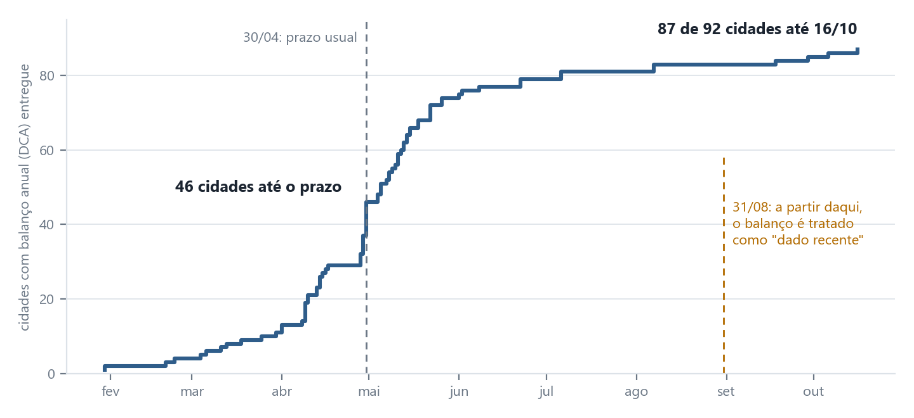

# Como acompanhar as contas da saúde sem perder o rumo

**Documento 2 · Plano de controle — Saúde fiscal do Rio de Janeiro · Siconfi 2023 a 2025 · 25/10/2026**

<b>9 meses</b>é o tempo, na prática, para o balanço anual de todas as cidades ficar completo (em 2025, as entregas foram de janeiro a outubro de 2026)

**Em poucas linhas.** Este plano diz o que olhar nas contas de saúde de uma cidade, de onde vem cada dado, quando um número merece atenção e o que fazer depois. Serve a quem trabalha com controle, auditoria, finanças ou gestão, e a qualquer pessoa que queira acompanhar a cidade onde mora. Nada foi aplicado em órgão nenhum: é uma proposta. Os dados são declarados pelas prefeituras e pelo estado, e não foram auditados. Gasto em saúde não mede qualidade do atendimento.

## 1. Seis coisas para acompanhar

**Regra de ouro:** um alerta é um convite para olhar, nunca uma conclusão. A cidade que dispara um alerta não está errada: pode haver uma explicação legítima que os dados públicos não mostram.

| Ferramenta | O que acompanha | Quando avisa | O que fazer |
|---|---|---|---|
| **Triagem** | Cidades que gastam em saúde bem abaixo do que a receita delas indica | Gasto abaixo da faixa esperada e abaixo também no ano anterior | Pedir a explicação à secretaria antes de qualquer auditoria |
| **Cidades parecidas** | Cada cidade comparada com outras de receita parecida, e não com a região | Não é alerta: é a régua de leitura | Ler a cidade contra os pares da sua faixa |
| **Dependência de repasses** | Quanto da receita vem de repasses, como os do SUS | Mais de 90% da receita vindo de repasses* | Rodar cenários de queda de 10%, 20% e 30% |
| **Folga sobre o mínimo** | Quanto a cidade aplica acima dos 15% da lei | Folga menor que 3 pontos percentuais (atenção); menor que 1 (alta) | Acompanhar o ano seguinte |
| **Conferência entre fontes** | O SIOPS e o Siconfi contando a mesma história | Razão fora do padrão das demais | Tratar como pergunta de conciliação, nunca como alarme sozinho |
| **Limites da lei** | Pessoal, dívida e restos a pagar contra os limites da Lei de Responsabilidade Fiscal | Pessoal acima do limite prudencial; dívida a partir de 80% do limite | Conferir antes se o dado é atípico |

\* Esse limite é uma escolha minha, não uma regra legal.

**Quem olha:** a controladoria da própria prefeitura, o tribunal de contas, a secretaria de finanças, o gestor e, para o que é público, o conselho de saúde e qualquer cidadã ou cidadão.

## 2. Quando o dado está pronto

**Um balanço anual leva meses para chegar.** Em 2025, 46 das 87 cidades que já entregaram o fizeram até o prazo usual de 30 de abril. As demais foram chegando até outubro, e quatro entregaram depois de 31 de agosto.

> [!WARNING]
> **Período incompleto não se interpreta.** Se menos de 95% das cidades entregaram, ou se uma cidade em alerta ainda não entregou, o ano aparece como **"em atualização"**. Cidade sem dado aparece como "sem dado", nunca como zero.

## 3. O que invalidaria esta análise

| Se acontecer | O que muda | Quando revisar |
|---|---|---|
| Nova regra de repasses do SUS | A relação entre repasses e gasto | Ao ser publicada |
| Mudança nos 15% da lei ou nos limites da LRF | Folga e limites | Ao ser publicada |
| Mudança nos formulários do Siconfi | Os testes automáticos falham | No mesmo dia |
| Novo Censo ou nova estimativa de população | Tudo que é "por habitante" | Ao ser divulgada |
| Troca de mandatos municipais (2025 e 2029) | Prioridades de gasto mudam | Todo ano de início de mandato |
| Queda forte de royalties do petróleo | Receita de cidades que dependem deles | Quando o preço variar muito |
| Mudança de quem atende a população (hospital federal ou estadual) | O gasto municipal por habitante, em especial na capital | Ao saber da mudança |

**Revisão regular:** uma vez por ano, quando o balanço anual estiver maduro, por volta de outubro.

## 4. Quando refazer a triagem

A triagem usa uma regressão. Ela deve ser refeita se a elasticidade da receita sair da faixa de **0,60 a 0,95** (em 2023, 2024 e 2025 foi de 0,80, 0,81 e 0,74), se o poder de explicação cair abaixo de **0,70** (hoje, cerca de 0,80) ou se mudar a lista de cidades.

## 5. O que dá para reaproveitar

| Padrão | Para que serve |
|---|---|
| Separar "tem pouco" de "dedica pouco" | Qualquer indicador por habitante, em outros estados e outras áreas |
| Prever cada cidade sem usá-la na régua | Achar quem destoa sem que a cidade puxe a régua |
| Comparar por faixas de receita | Ler cada cidade contra quem se parece |
| Escrever as previsões antes de abrir o dado novo | Qualquer confirmação com dados futuros |
| Testar a fonte antes de planejar | Todo projeto com dado público |
| Marcar o período incompleto | Qualquer série com atraso de registro |

## 6. Limites

Este plano não substitui uma auditoria e não decide se um gasto está certo. Não mede resultado de saúde. Os limites vêm dos dados do Rio de Janeiro de 2023 a 2025 e não foram testados em outro lugar. Os testes automáticos do dado rodam a cada mudança no repositório e avisam se algo quebrou.

## Para saber mais

Versão técnica do plano e todos os dados: [github.com/MatheusAugustoEC/saude-rj](https://github.com/MatheusAugustoEC/saude-rj).
