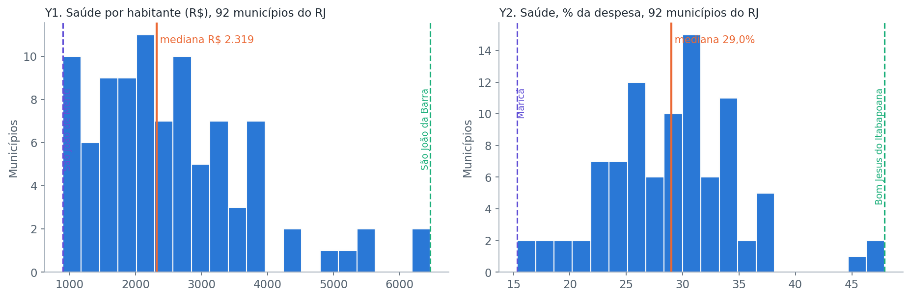
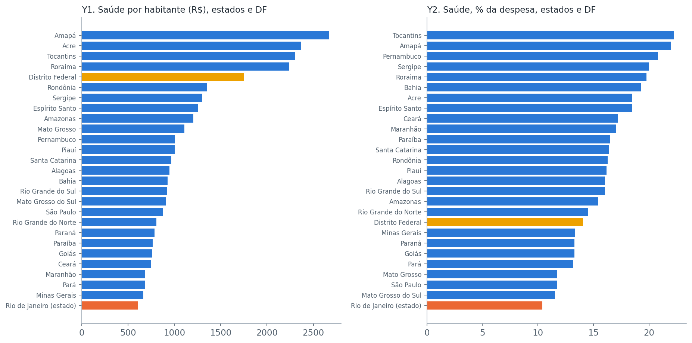
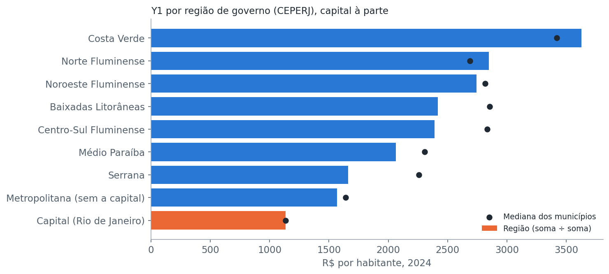

# O gasto em saúde por habitante varia 7,2 vezes entre os municípios do RJ, e a mediana é R$ 2.319

Fase 2B · Measure, o processo — Saúde fiscal do Rio de Janeiro · 23/10/2026 · exercício de 2024 · versão 1

<b>R$ 900 a R$ 6.465</b>gasto em saúde por habitante, 92 municípios do RJ, 2024 (menor: São João de Meriti; maior: São João da Barra)

<b>R$ 606</b>gasto por habitante do estado do RJ, o menor entre os 27 estados e o DF (mediana: R$ 946)

<b>29,0%</b>mediana da fatia da despesa que vai para saúde nos municípios (estados: 16,2%)

**Em três linhas.** Medi o que o processo entrega hoje: quanto cada município e cada estado gasta em saúde por habitante e como fatia da despesa. Congelei esses números como linha de base. Das 8 regiões, só 3 têm municípios suficientes para sustentar uma comparação.

## 1. A pergunta desta fase

**Qual é o ponto de partida?** Antes de explicar por que os entes gastam diferente, preciso saber, com o dado já conferido na fase anterior, quanto eles gastam hoje. Esses números ficam congelados: tudo o que vier depois será medido contra eles.

## 2. O que eu encontrei

### Os municípios gastam de R$ 900 a R$ 6.465 por habitante, e poucos puxam a média para cima

A mediana é R$ 2.319 e metade dos municípios está entre R$ 1.689 e R$ 3.217. A cauda longa à direita (assimetria de 1,11) mostra que poucos municípios gastam muito por habitante. A fatia da despesa em saúde é bem mais concentrada: de 15,3% (Maricá) a 47,9% (Bom Jesus do Itabapoana), com mediana de 29,0%.

| Grupo | n | Y1: saúde por habitante, mediana (Q1 a Q3) | Y2: fatia da saúde, mediana (Q1 a Q3) |
|---|---|---|---|
| Municípios do RJ | 92 | R$ 2.319 (R$ 1.689 a R$ 3.217) | 29,0% (25,2% a 32,6%) |
| Estados e DF | 27 | R$ 946 (R$ 775 a R$ 1.277) | 16,2% (13,3% a 18,5%) |

> [!NOTE]
> **Detalhe técnico (M5, M6).** Mediana e quartis no lugar de média e desvio, porque a distribuição é assimétrica. Tirar os 4 municípios com dado em dúvida muda a mediana em menos de 2% (R$ 2.282 e 29,3%): **a conclusão não depende deles**. Estados e municípios ficam separados porque têm papéis e receitas diferentes na saúde.

### O estado do RJ é o que menos gasta por habitante e o que menor fatia dedica à saúde

O estado gasta **R$ 606** por habitante (a mediana dos estados é R$ 946) e dedica 10,4% da despesa à saúde (a mediana é 16,2%), os menores dos 27. O maior gasto por habitante é do Amapá (R$ 2.666), e a maior fatia é do Tocantins (22,3%). O DF fica à parte porque acumula funções de estado e de município.

> [!WARNING]
> **Cuidado.** Gasto por habitante acompanha a receita por habitante (correlação de 0,80 nos estados e 0,87 nos municípios). Um número baixo não prova que a saúde é pior, e um alto não prova que é melhor: o dado mostra gasto, não qualidade.

### A capital gasta R$ 1.136 por habitante e dedica 19,3% da despesa à saúde

Entre os 92 municípios, a capital é a 85ª em gasto por habitante (uma das 8 menores) e a 88ª em fatia da despesa. A Região Metropolitana sem a capital (21 municípios) gasta R$ 1.570 por habitante, somando a saúde e dividindo pela população, e é a região de menor gasto depois da capital.

### Só 3 das 8 regiões têm municípios suficientes para sustentar uma comparação

Calculei a menor diferença que o n de cada região conseguiria enxergar: **Costa Verde (3 municípios) só mostraria uma diferença de 111%**, e as regiões Norte Fluminense, Baixadas Litorâneas, Centro-Sul e Médio Paraíba precisariam de diferenças de 51% a 57%. Só Noroeste, Serrana e Metropolitana (sem a capital) sustentam uma comparação com a regra que escolhi (menos de 50%). A capital, com n = 1, só pode ser descrita.

| Região | Municípios | Saúde por habitante (soma ÷ soma) | Sustenta comparação? |
|---|---|---|---|
| Costa Verde | 3 | R$ 3.629 | não (efeito mínimo de 111%) |
| Norte Fluminense | 9 | R$ 2.847 | não (57%) |
| Noroeste Fluminense | 13 | R$ 2.743 | sim (47%) |
| Baixadas Litorâneas | 10 | R$ 2.419 | não (53%) |
| Centro-Sul Fluminense | 11 | R$ 2.390 | não (51%) |
| Médio Paraíba | 11 | R$ 2.062 | não (51%) |
| Serrana | 13 | R$ 1.662 | sim (47%) |
| Metropolitana (sem a capital) | 21 | R$ 1.570 | sim (37%) |
| Capital | 1 | R$ 1.136 | só descrição |

> [!NOTE]
> **Detalhe técnico (M17, M19).** A taxa da região soma o numerador e o denominador; a média simples das taxas erraria até R$ 673 por habitante (na Serrana). O efeito mínimo detectável usa escala de log, nível de 5% e poder de 80%, contra o resto dos municípios. O corte de 50% é uma escolha minha, não uma norma.

### Nenhum município aparece abaixo do mínimo de saúde, mas isso não prova que a taxa verdadeira seja zero

0 de 92 municípios estão abaixo dos 15% da LC 141. Com 92 observações, o intervalo de Wilson vai de 0% a 4,0%. Outras proporções: 7 de 92 gastam mais de 115% da receita (7,6%, de 3,7% a 14,9%) e 22 de 92 têm pessoal do Executivo acima do limite prudencial declarado (23,9%, de 16,4% a 33,6%).

## 3. O que eu decidi

> [!TIP]
> **Decisões**, cada uma com a alternativa descartada.

| Escolha | O que usei | O que mais considerei | Por que esta | Evidência | Regra |
|---|---|---|---|---|---|
| Centro e dispersão | Mediana e quartis | Média e desvio-padrão (convencional) | A distribuição dos municípios é assimétrica | Tabela da seção 2 | M6 |
| Intervalo de proporção | Wilson 95% | Wald (convencional) | Com 0 casos em 92, o Wald daria intervalo zero | Notebook 02, seção 7 | M7 |
| Agregado de região | Soma ÷ soma | Média das taxas (convencional) | A média dá o mesmo peso a município pequeno e grande | Notebook 02, seção 8 | M17 |
| Corte de poder estatístico | Efeito mínimo de 50% | Corte de 30%; teste de permutação | Regra simples e dita; é escolha minha | Notebook 02, seção 9 | M19 |
| Estados e municípios | Separados | Juntos num só ranking | Papéis e receitas diferentes na saúde | Seção 2 | M6 |
| Baseline | Gravado, com SHA-256, imutável | Recalcular a cada versão | Linha de base que muda vira alvo móvel | `artefatos/baseline_measure_2024.csv` | M22 |

**O que não se aplica, e por quê.** Cartas de controle e estabilidade (M8 a M15), capabilidade (M16), deflação (M20) e quebra de série (M21) não valem: o projeto tem **um só ano e um corte transversal**, e não há meta numérica. Isso impede concluir se as diferenças entre entes são estáveis no tempo.

## 4. Para você explicar esta fase

**A fase em 30 segundos.** Medi quanto cada município e cada estado gasta em saúde por habitante e como parte da despesa. Entre os municípios do RJ a diferença é de 7 vezes, de R$ 900 a R$ 6.465. O estado do RJ é o que menos gasta por habitante entre os 27. Congelei isso como linha de base e descobri que, por região, muitos recortes têm poucos municípios para sustentar conclusão.

**As perguntas que vão te fazer**

- **Por que mediana e não média?** Porque poucos municípios gastam muito, e a média seria puxada por eles. A mediana mostra o município típico.
- **Por que não comparou as regiões já?** Porque, com 3 a 13 municípios por região, só uma diferença muito grande apareceria. Comparar sem checar isso levaria a "não há diferença" onde só não há dado.
- **Por que somar em vez de tirar a média da região?** A média simples dá o mesmo peso a um município de 5 mil e a um de 800 mil habitantes, e daria até R$ 673 de diferença.
- **Por que não fez carta de controle?** O projeto tem um só ano; sem série no tempo, não dá para avaliar estabilidade, e eu disse isso.
- **Esse baseline é a verdade?** É o ponto de partida do dado declarado pelos entes, com o que consegui conferir. Os números mudam se a população ou o dado de algum ente mudar.

**Os números para saber de cor.** Municípios: R$ 900 a R$ 6.465, mediana de R$ 2.319 (7,2 vezes). Estado do RJ: R$ 606, o menor entre os 27. Fatia da saúde: mediana de 29,0% nos municípios.

## 5. O que ainda não sei

- **Se a diferença entre entes é estável.** Só tenho 2024.
- **Por que os municípios gastam diferente.** Esta fase descreve; explicar é do Analyze.
- **O que ocorre nas regiões pequenas.** Costa Verde e outras 4 regiões não sustentam comparação com o n atual. Em vez de testar, o Analyze descreve e avisa.
- **O Distrito Federal** ainda não tem o indicador de mínimo legal, e entra como caso especial.

## 6. O veredito

| Critério | Veredito | Motivo |
|---|---|---|
| Distribuição inteira dos dois Y descrita | OK | Municípios e estados, com nomes dos extremos |
| Proporções com intervalo e n | OK | Wilson em todas |
| Taxas agregadas por soma | OK | Regiões com soma ÷ soma |
| Poder estatístico antes de estratificar | OK | 5 de 8 regiões sem poder, declaradas |
| Estabilidade no tempo | RESSALVA | Não avaliável: um só ano |
| Baseline congelado | OK | Arquivo com SHA-256, imutável |
| Cobertura | RESSALVA | DF sem o indicador de mínimo legal |

**Tollgate: aprovado com ressalva.**

## 7. O próximo capítulo

O Analyze testa os X (receita por habitante, peso de pessoal, dívida, restos a pagar, população, região) contra os dois Y. **O que o Analyze precisa saber:** (1) região só descreve nas 5 regiões sem poder; (2) a capital é sempre à parte; (3) gasto por habitante acompanha a receita, então a fatia da despesa é a medida de prioridade; (4) os casos marcados continuam sendo mostrados com e sem.

## Bastidores

1. Notebook: `notebooks/02_measure_qualidade_e_baseline.ipynb` (gera os gráficos, a tabela de qualidade e o baseline).
2. Baseline congelado: `fases/fase-2b-measure-baseline/artefatos/baseline_measure_2024.csv`, com `baseline_measure_2024.sha256`.
3. Colunas novas (regiões, limites legais): `dados_tratados/indicadores_measure_2024.csv`.
