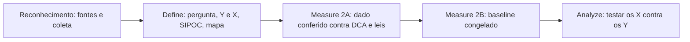

# Saúde fiscal do Rio de Janeiro

| Fase | Status | Tollgate | Relatório | Data |
|---|---|---|---|---|
| 0 · Reconhecimento | feita antes do método (viabilidade e coleta) | — | [docs/02](../docs/02-fontes-de-dados.md), [docs/03](../docs/03-relatorio-coleta.md) | 21/10/2026 |
| 1 · Define | concluída | declaração do problema aprovada | [docs/01](../docs/01-define-relatorio.md) | 22/10/2026 |
| 2A · Measure, o instrumento | concluída | APROVADO COM RESSALVA | [relatório](fase-2a-measure-qualidade/relatorio.pdf) | 23/10/2026 |
| 2B · Measure, o processo | concluída | APROVADO COM RESSALVA | [relatório](fase-2b-measure-baseline/relatorio.pdf) | 23/10/2026 |
| 3 · Analyze | concluída | APROVADO | [relatório](fase-3-analyze/relatorio.pdf) | 24/10/2026 |
| 4 · Improve | não iniciada | — | — | — |
| 5 · Control | não iniciada | — | — | — |

Marco 1 (Define) publicado no LinkedIn pelo Matheus em 22/10/2026.

## Fluxo

## Decisões que atravessam o projeto

| Decisão | Fase de origem |
|---|---|
| Pergunta central e Y: gasto em saúde por habitante (Y1) e fatia da despesa (Y2); usar "gasta", não "investe" | Define |
| Escopo: Siconfi como núcleo; IBGE, SUS e SIOPS como módulos | Define |
| Regiões: 8 Regiões de Governo do CEPERJ, capital à parte, só descrição onde o n não sustenta | Define, Measure 2B |
| Atípicos e relatórios simplificados: manter, marcar e mostrar com e sem | Define |
| População: estimativa 2024 do IBGE | Measure 2A |
| Saúde de Búzios pela DCA | Measure 2A |
| Limites legais (LRF, Resolução do Senado 40/2001, LC 141) ao lado dos declarados | Measure 2A |
| O que fica sem explicação é achado de auditoria, com ressalva | Measure 2A |
| Todo insight vai com a ressalva (gasto não é qualidade) | Define |
| DF fora do SIOPS por enquanto; retomar ao terminar o núcleo | Measure 2A |
| Recorte "núcleo da Baixada": 6 municípios, rotulado como escolha analítica; só descrição (n = 6) | Measure 2A, decisão de 23/10/2026 |
| Repositório público no GitHub, com todos os dados brutos; licença MIT (código) e CC BY 4.0 (textos e análises); rótulos de dado em dúvida mantidos | decisão de 23/10/2026 |
